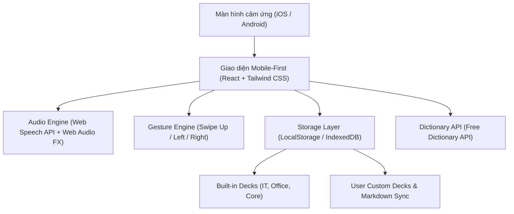
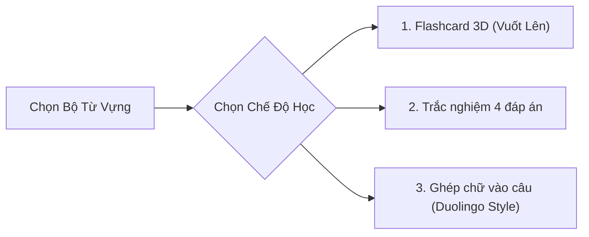
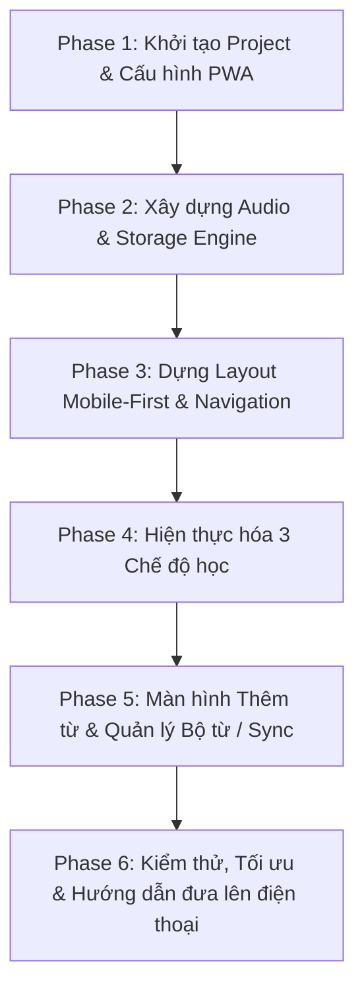

# Kế hoạch triển khai: VocabFlow PWA (Ứng dụng Flashcard tiếng Anh Mobile-First)

Tài liệu này đặc tả chi tiết kiến trúc, tính năng và lộ trình thực thi để xây dựng ứng dụng web học từ vựng tiếng Anh **VocabFlow PWA**, tối ưu hóa cho màn hình cảm ứng điện thoại (iOS Safari & Android Chrome), hỗ trợ hoạt động offline và tích hợp đầy đủ các chế độ học tập đã thống nhất.

---

## 1. Tổng quan dự án

* **Tên ứng dụng:** VocabFlow PWA
* **Đường dẫn mã nguồn:** `C:\gehihi\projects\vocab-flashcard-pwa`
* **Hình thức ứng dụng:** Progressive Web App (PWA) — Có thể cài đặt trực tiếp lên Màn hình chính (Home Screen) của iPhone và Android, chạy toàn màn hình (Standalone) không thanh URL như app native.
* **Mục tiêu cốt lõi:**
  1. Hỗ trợ học từ vựng nhanh chóng, tiện dụng mọi lúc mọi nơi trên điện thoại.
  2. Cung cấp 3 chế độ học đa giác quan: Nhìn nhận diện, Phản xạ nhanh, và Nghe - Ghép chữ vào câu ngữ cảnh thực tế.
  3. Quản lý linh hoạt: Có sẵn các bộ từ vựng thực chiến (IT, Công sở) và hỗ trợ người dùng tự tạo bộ từ riêng, đồng bộ hai chiều với file Markdown (tương thích repo `daily-english`).

---

## 2. Kiến trúc kỹ thuật (Tech Stack & Architecture)



| Thành phần | Công nghệ lựa chọn | Lý do |
| :--- | :--- | :--- |
| **Core Framework** | React 18 / 19 + TypeScript + Vite | Tốc độ build siêu nhanh, code chặt chẽ, dễ bảo trì. |
| **Styling** | Tailwind CSS + Lucide Icons | Giao diện hiện đại, tối ưu 100% cho màn hình cảm ứng và Dark Mode. |
| **Hiệu ứng 3D & Cử chỉ** | Touch Event Handlers + CSS 3D Transforms | Tối ưu hiệu năng, phản hồi cử chỉ vuốt nhạy bén, không bị trễ khung hình. |
| **PWA & Offline** | `vite-plugin-pwa` + Service Worker | Tự động sinh `manifest.json`, lưu cache toàn bộ app để chạy offline khi không có 4G/Wifi. |
| **Phát âm từ vựng** | Web Speech API (`SpeechSynthesis`) | Giọng đọc tiếng Anh chuẩn bản xứ tích hợp sẵn trong iOS/Android, không tốn phí, không cần mạng. |
| **Hiệu ứng âm thanh** | Web Audio API (`AudioContext`) | Tự tổng hợp âm thanh chúc mừng "ting ting", "click", "buzz" trực tiếp bằng code, dung lượng app nhẹ 0 KB âm thanh. |
| **Lưu trữ dữ liệu** | LocalStorage / IndexedDB | Dữ liệu lưu vĩnh viễn trên trình duyệt của máy, không phụ thuộc server bên ngoài. |
| **Tra cứu tự động** | Free Dictionary API | API mở miễn phí 100%, không cần đăng ký token/key. |

---

## 3. Đặc tả chi tiết các phân hệ chức năng

### 3.1. Phân hệ Quản lý Bộ câu hỏi (Deck Management)
Trước khi vào bất kỳ chế độ học nào, người dùng có thể chọn bộ từ muốn học:
1. **Bộ mặc định có sẵn (Built-in Decks):**
   * 💻 **IT & Dev English (50 từ):** Các từ ngữ chuyên ngành thực chiến (`retrieve`, `compile`, `exception`, `refactor`, `payload`, `deprecated`, `concurrency`...).
   * 🏢 **Office & Meeting (40 từ):** Giao tiếp công sở (`align`, `estimate`, `postpone`, `wrap up`, `deadline`, `agenda`...).
   * 🌟 **500 Core Daily Words:** Từ vựng giao tiếp cốt lõi.
2. **Bộ do người dùng tự tạo (User Custom Decks):**
   * Cho phép tạo mới bộ từ (ví dụ: `Day-02 English`, `Học tuần này`, `Dự án EAS`).
   * Thêm/Sửa/Xóa từ trong bộ.

---

### 3.2. Phân hệ 3 Chế độ Luyện tập (Study Modes)



#### Chế độ 1: Flashcard 3D Cảm ứng (Vuốt Lên)
* **Mặt trước:** Hiện từ tiếng Anh, từ loại, nút Loa phát âm.
* **Cử chỉ tương tác:**
  * **Vuốt LÊN (Swipe Up ⬆️):** Kích hoạt hiệu ứng 3D lật 180° để xem mặt sau.
* **Mặt sau:** Hiện phiên âm IPA, nghĩa tiếng Việt rõ ràng, câu ví dụ tiếng Anh thực tế.
* **Đánh giá ghi nhớ:**
  * **Vuốt PHẢI (Swipe Right ➡️)** hoặc bấm nút xanh 🟢: Đã thuộc $\rightarrow$ Thẻ bay sang phải, qua từ tiếp theo.
  * **Vuốt TRÁI (Swipe Left ⬅️)** hoặc bấm nút cam 🟠: Chưa nhớ $\rightarrow$ Thẻ tự động xếp vào cuối hàng đợi để ôn lại cho đến khi thuộc.

#### Chế độ 2: Trắc nghiệm 4 đáp án (Multiple Choice Quiz)
* Hiển thị từ tiếng Anh + Nút phát âm.
* 4 nút lựa chọn nghĩa tiếng Việt được xáo trộn từ các từ trong cùng bộ.
* Chạm chọn:
  * Đúng: Nháy xanh 🟢 + tiếng "ting" + tự động chuyển câu sau 0.8s.
  * Sai: Nháy đỏ 🔴 + làm nổi bật đáp án đúng để người dùng ghi nhớ.

#### Chế độ 3: Ghép chữ cái vào câu (Duolingo-style Spelling Tiles)
* Hiển thị câu tiếng Anh có chỗ trống: `"We need to [ _____ ] the signed PDF file."`
* Hiển thị gợi ý nghĩa tiếng Việt và phiên âm IPA bên dưới.
* Phía dưới là các **bong bóng chữ cái xáo trộn** (`r`, `e`, `t`, `i`, `v`, `e`...):
  * Chạm từng chữ: Có âm thanh "click" nhẹ, chữ bay lên ô trống. Chạm vào chữ trên ô trống để gỡ ra xếp lại.
* **Cơ chế phản hồi khi GHÉP ĐÚNG (Success):**
  1. 🔔 Phát chuông chúc mừng "ting ting" vui tai.
  2. 🔊 **Tự động kích hoạt giọng đọc bản xứ đọc to, rõ ràng từ tiếng Anh đó** để người học ghi nhớ ngữ âm.
  3. Ô chữ cái chuyển sang màu **Xanh lá cây 🟢**, câu hoàn chỉnh sáng lên và tự động chuyển câu tiếp theo sau 1s.
* **Cơ chế phản hồi khi GHÉP SAI (Wrong Spelling):**
  1. 🔊 **Âm thanh cảnh báo:** Phát tiếng "buzz / thud" trầm nhẹ báo hiệu xếp chưa đúng.
  2. 📳 **Hiệu ứng thị giác:** Các ô chữ vừa xếp lập tức chuyển sang viền/nền **Màu Đỏ 🔴** và **rung lắc nhẹ (shake animation)** trong 0.4s.
  3. ↩️ **Cơ chế sửa sai linh hoạt:**
     * Chạm vào chữ cái bị sai trên ô trống để chữ đó rơi ngược lại xuống kho bong bóng.
     * Nút **"Làm lại" (Clear all)**: Chạm 1 click để hoàn trả toàn bộ chữ cái về vị trí ban đầu và xếp lại từ đầu.
  4. 💡 **Trợ giúp & Xếp lại vào hàng đợi ôn tập:**
     * Nếu sai hoặc bí: Có nút *"Xem đáp án"* $\rightarrow$ Hệ thống tự điền từ đúng, phát âm thanh đọc từ vựng cho người dùng nghe.
     * **Quy tắc SRS bắt buộc:** Bất kỳ từ nào bị ghép sai sẽ **tự động bị đưa vào cuối danh sách bài học**, yêu cầu người dùng phải ghép lại chính xác vào cuối phiên thì mới được tính là hoàn thành bài học!

---

### 3.3. Phân hệ Thêm từ & Đồng bộ dữ liệu (Input & Sync)
* **Form Thêm từ siêu tốc:**
  * Nhập từ tiếng Anh $\rightarrow$ Bấm nút "Tra cứu": Tự động gợi ý IPA, audio, câu ví dụ (nghĩa tiếng Việt do người dùng tự nhập — xem Mục 10/Q1).
  * Cho phép chỉnh sửa lại nghĩa/ví dụ theo ý muốn $\rightarrow$ Chọn Bộ từ lưu trữ $\rightarrow$ Bấm "Lưu thẻ".
* **Đồng bộ Markdown & JSON:**
  * Nút **"Xuất Markdown"**: Tải về hoặc copy toàn bộ từ vựng ra định dạng bảng Markdown (tương thích để paste vào `C:\gehihi\projects\daily-english`).
  * Nút **"Nhập nhanh"**: Dán danh sách từ dạng text/markdown vào để app tự động sinh hàng loạt thẻ học.

---

## 4. Lộ trình thực hiện chi tiết (Implementation Phases)



### Bước 1: Khởi tạo Project & Cấu hình PWA (10 phút)
1. Tạo thư mục dự án tại `C:\gehihi\projects\vocab-flashcard-pwa`.
2. Khởi tạo template `Vite + React + TypeScript`.
3. Cài đặt các dependencies cần thiết:
   * `tailwindcss`, `postcss`, `autoprefixer`
   * `lucide-react` (bộ icon mobile hiện đại)
   * `vite-plugin-pwa` (cấu hình PWA manifest, icon, service worker offline)
   * `canvas-confetti` (hiệu ứng pháo hoa chúc mừng khi hoàn thành bài học)

### Bước 2: Xây dựng Audio & Storage Engine (10 phút)
1. **`sound-fx.ts`:** Dùng Web Audio API tạo bộ âm thanh không cần tải file mp3 (tiếng chuông ting ting, click phím, buzz lỗi).
2. **`tts.ts`:** Dùng Web Speech API bọc chuẩn giọng đọc tiếng Anh Mỹ/Anh (`en-US` / `en-GB`), tối ưu hoạt động mượt mà trên iOS Safari và Android.
3. **`initial-decks.ts`:** Soạn sẵn 3 bộ từ vựng mẫu chất lượng cao (IT & Dev, Office, Daily).
4. **`storage-service.ts`:** Quản lý CRUD từ vựng và bộ từ trong `localStorage`, kèm chức năng export/import Markdown.

### Bước 3: Dựng Layout Mobile-First & Navigation (10 phút)
1. Thiết kế khung Mobile-First (tỷ lệ chuẩn điện thoại, căn giữa trên màn hình máy tính).
2. Thanh điều hướng đáy (Bottom Navigation Bar) 3 tab chính:
   * 🎴 **Luyện tập (Practice)**
   * ➕ **Thêm từ (Add Word)**
   * 📚 **Kho từ (Library & Decks)**
3. Hỗ trợ Dark Mode tự động theo hệ điều hành hoặc nút gạt thủ công.

### Bước 4: Hiện thực hóa 3 Chế độ học (20 phút)
1. Xây dựng màn hình chọn Bộ từ vựng và chọn Chế độ học.
2. **Chế độ Flashcard 3D:**
   * CSS 3D flip animation (`perspective`, `rotateX`).
   * Touch gestures: Nhận diện vuốt LÊN (lật thẻ), vuốt TRÁI (chưa nhớ), vuốt PHẢI (đã thuộc).
3. **Chế độ Trắc nghiệm:**
   * Thuật toán bốc ngẫu nhiên 3 đáp án nhiễu từ cùng bộ từ.
   * Xử lý trạng thái nháy xanh/đỏ và âm thanh phản hồi.
4. **Chế độ Ghép chữ cái:**
   * Tách từ thành các mảng chữ cái bị xáo trộn.
   * Logic chọn/bỏ chọn chữ cái.
   * **Cơ chế âm thanh kép:** Phát chuông ting ting + kích hoạt TTS đọc từ tiếng Anh ngay khi hoàn thành đúng.

### Bước 5: Màn hình Thêm từ & Quản lý Kho từ / Sync (10 phút)
1. Form nạp từ tích hợp gọi Free Dictionary API tự động.
2. Danh sách kho từ có tìm kiếm, bộ lọc trạng thái (Đã thuộc / Chưa nhớ).
3. Modal Xuất/Nhập file Markdown/JSON.

### Bước 6: Kiểm thử & Hướng dẫn đưa lên điện thoại (10 phút)
1. Chạy `npm run build` để kiểm tra TypeScript và bundle PWA không có lỗi.
2. Chạy preview local server có cấu hình mở IP mạng LAN (để mở bằng Safari/Chrome trên cùng mạng Wifi).
3. Hướng dẫn từng bước cách đưa link lên iPhone/Android và thêm vào Màn hình chính.

---

## 5. Tiêu chuẩn nghiệm thu (Acceptance Criteria)

- [ ] Project chạy độc lập tại `C:\gehihi\projects\vocab-flashcard-pwa`, `npm run build` 0 lỗi.
- [ ] Mở trên trình duyệt điện thoại hiển thị chuẩn tỉ lệ, không bị tràn màn hình.
- [ ] Chế độ Flashcard nhận diện cử chỉ **Vuốt Lên** để xem nghĩa và **Vuốt Trái/Phải** để đánh giá.
- [ ] Chế độ Ghép chữ: Khi ghép đúng, tự động phát âm thanh chuông chúc mừng + giọng đọc tiếng Anh bản xứ.
- [ ] Có sẵn ít nhất 2 bộ từ vựng mẫu (IT & Dev, Office) kèm tính năng tạo bộ từ cá nhân.
- [ ] Nút Xuất file Markdown hoạt động chuẩn, xuất ra danh sách từ vựng sạch sẽ.
- [ ] Cài đặt được thành icon app độc lập trên màn hình chính điện thoại qua PWA.

---

## 6. Chiến lược Debugging, Xử lý Lỗi & Phòng vệ Hệ thống (Error Recovery Matrix)

Tuân thủ nguyên tắc **Systematic Root-Cause Debugging & Safe Fallbacks** từ kỹ năng `debugging-and-error-recovery`:

| Phân tầng lỗi | Tình huống lỗi cụ thể | Nguy cơ crash / Bug | Cơ chế Phòng vệ & Khôi phục (Recovery Mechanism) |
| :--- | :--- | :--- | :--- |
| **UI / Render Error** | Component con bị crash do dữ liệu bất thường (ví dụ: thẻ từ thiếu trường) | Màn hình trắng xóa toàn app (White screen of death) | **Global React ErrorBoundary:** Bọc toàn bộ App bằng Component bắt lỗi. Nếu có crash cục bộ, giao diện hiển thị màn hình cứu hộ thân thiện: *"Đã xảy ra lỗi hiển thị - [Tải lại trang] hoặc [Khôi phục dữ liệu gốc]"*, tuyệt đối không để trắng màn hình. |
| **Storage / Data Corruption** | Dữ liệu `localStorage` bị hỏng cấu trúc JSON (SyntaxError) | App crash ngay khi vừa mở trang (khởi động thất bại) | **Safe Storage Wrapper:** Toàn bộ lệnh `JSON.parse` đều bọc trong `try/catch`. Nếu parse lỗi, tự động sao lưu chuỗi lỗi sang key backup và fallback về bộ từ vựng mặc định an toàn (`initialDecks`). |
| **Audio / Speech API** | `window.speechSynthesis.getVoices()` trả về mảng rỗng `[]` khi app vừa mount | Không đọc được tiếng Anh do chưa tải xong danh sách giọng | **Async Voice Listener:** Lắng nghe sự kiện `speechSynthesis.onvoiceschanged`. Khi danh sách giọng sẵn sàng mới gán giọng đọc `en-US`/`en-GB`. Có fallback về giọng mặc định của hệ thống nếu không có giọng Anh chuẩn. |
| **API / Network Failure** | Gọi Free Dictionary API bị lỗi 404, 429 hoặc rớt mạng | Treo loading vô tận hoặc nút bấm bị đơ | **Strict HTTP Triage:** <br>• Lỗi 404: Báo nhẹ *"Từ này chưa có trong từ điển mở, mời bạn tự điền nghĩa"*. <br>• Lỗi mạng/500: Tự động tắt spinner sau 3s timeout và mở form nhập thủ công. |
| **State / Empty Collection** | Bộ từ vựng trống (0 từ) nhưng người dùng bấm "Luyện tập" | Lỗi chia cho 0 (`0/0 = NaN%`), crash thuật toán bốc 4 đáp án trắc nghiệm | **Empty State Guard:** Kiểm tra `deck.words.length === 0` ngay từ màn hình chọn. Nếu rỗng, khóa nút bắt đầu và hiện thông báo: *"Bộ từ này chưa có thẻ nào, hãy thêm từ trước nhé!"*. |
| **PWA Service Worker Cache** | Bản cập nhật code mới bị Service Worker cũ giữ lại trong cache | Người dùng dùng code cũ dính bug đã sửa | **Auto-Update Prompt:** Cấu hình `registerType: 'autoUpdate'` hoặc hiện thông báo *"Đã có bản cập nhật mới - [Làm mới ngay]"* khi có service worker mới kích hoạt. |

---

## 7. Đính chính spec trước khi code (kết quả rà soát lại 316 mục)

> [!WARNING]
> Rà soát lại cho thấy một số mục trong `vocab-flashcard-pwa-features-spec.md` **sai về kỹ thuật hoặc không chạy được trên web**. Nếu code theo nguyên văn sẽ phát sinh bug thật hoặc tốn công vô ích. Plan này là nguồn sự thật (source of truth); spec chỉ dùng tham khảo.

### 7.1. Lỗi chặn (BLOCKER) — phải xử lý trước
| # | Vấn đề | Vì sao sai | Hướng xử lý |
|---|---|---|---|
| B1 | **Free Dictionary API không trả nghĩa tiếng Việt** | API chỉ có định nghĩa tiếng Anh, IPA, audio. Mục 3.3 của plan ghi "tự điền nghĩa tiếng Việt" là không thể. | Tự điền IPA/audio/ví dụ; **nghĩa tiếng Việt người dùng tự nhập** (hoặc chọn nguồn dịch khác, xem câu hỏi mở Q1). |
| B2 | **Regex lookbehind độ dài thay đổi** (`(?<!\([^)]*)` ở mục 182) | Safari < 16.4 không hỗ trợ → `SyntaxError` lúc parse **làm chết cả bundle JS**, trắng app. | Cấm lookbehind; tách nghĩa bằng vòng lặp đếm ngoặc. Thêm build target `safari15`. |
| B3 | **Chế độ ghép chữ: từ trong câu ví dụ bị biến hình** (`retrieve` → `retrieved/retrieving`, viết hoa đầu câu) | Không tìm thấy chỗ để khoét ô trống → câu không có blank hoặc khoét sai. | Tìm theo stem + không phân biệt hoa thường; nếu không khớp thì ghép chữ không kèm câu (chỉ hiện nghĩa + IPA). |
| B4 | **Quiz khi bộ từ < 4 nghĩa khác nhau** | Không đủ 3 đáp án nhiễu → vòng lặp không thoát hoặc hiện < 4 nút. | Nếu bộ < 4 từ: lấy nhiễu từ bộ có sẵn; nếu vẫn thiếu thì khóa chế độ Quiz kèm thông báo. |
| B5 | **Vòng ôn lại vô hạn** khi người dùng luôn vuốt trái / ghép sai | Từ sai bị đẩy cuối hàng đợi mãi → phiên học không bao giờ kết thúc. | Giới hạn mỗi từ tối đa 3 lần lặp trong 1 phiên, sau đó đánh dấu "cần ôn" và kết thúc phiên. |
| B6 | **Shuffle `sort(() => Math.random() - 0.5)`** (mục 187, 211, 291) | Phân phối lệch, có từ luôn đứng đầu; tile có thể trùng thứ tự đúng ngay từ đầu. | Dùng Fisher–Yates duy nhất; nếu sau xáo trùng thứ tự đúng thì xáo lại. |

### 7.2. Không hoạt động trên trình duyệt — loại bỏ khỏi phạm vi
| Mục spec | Lý do loại |
|---|---|
| Hạ âm lượng Spotify/Apple Music (Audio Ducking), 240, 253 | Trang web **không điều khiển được âm lượng app khác**. |
| EQ / compressor / dither / pre-roll 20Hz cho giọng đọc (181, 207, 269, 301) | `speechSynthesis` **không đi qua Web Audio graph**, không xử lý được. Compressor chỉ áp dụng cho tiếng chuông tự tổng hợp. |
| Phím `VolumeUp/VolumeDown` điều khiển thẻ (190) | Trình duyệt mobile không chuyển phím âm lượng cho trang web. |
| `webkitmouseforce*` chống 3D Touch (272) | Chỉ có trên trackpad macOS, không có trên iPhone. |
| `forced-color-adjust: none` chống đảo màu Android (282) | Thuộc tính này dành cho High Contrast của Windows; tắt nó làm hại người dùng cần độ tương phản cao. Chỉ giữ `<meta name="color-scheme">`. |
| Background Sync (258, 307) | iOS không hỗ trợ; app không có server nên không có gì để sync. |
| Web Share Target (197) | iOS Safari không hỗ trợ → chỉ là tính năng tùy chọn cho Android, để sau MVP. |
| `navigator.getBattery` (198) | Không có trên Safari/Firefox → chỉ dùng `prefers-reduced-motion`. |
| `user-scalable=no` (251) | iOS bỏ qua, ảnh hưởng accessibility. Chỉ dùng `touch-action: manipulation`. |
| Tự sinh câu ví dụ giả (302) | Câu bịa theo mẫu dễ sai ngữ pháp và gây hiểu sai nghĩa. Thay bằng ô trống cho người dùng tự nhập. |
| Bộ lọc "dấu chấm do bấm 2 lần cách" (275) | Regex làm hỏng câu hợp lệ. Thay bằng `autocorrect="off" autocapitalize="off" spellcheck="false"` trên input. |
| Regex CSV (180) | Regex sai với trường rỗng và `""` lồng nhau. Dùng parser kiểu state-machine (~30 dòng) hoặc bỏ CSV khỏi MVP, chỉ giữ Markdown/JSON. |

## 8. Thông số mâu thuẫn — chốt một giá trị duy nhất

| Thông số | Các giá trị đang mâu thuẫn trong spec | **Chốt** |
|---|---|---|
| Hướng lật thẻ (vuốt lên) | `rotateX` (plan) vs `rotateY` (spec) | `rotateX` (khớp cử chỉ vuốt lên) |
| Vùng chết mép màn hình | 20px / 25px / 40px | Ngang 24px, đỉnh 40px |
| Khóa sau khi vuốt | 400 / 350 / 250ms | 300ms (bằng thời lượng animation) |
| Tỷ lệ nhận diện trục vuốt | `|dx| > 2|dy|` / `> 1.5|dy|` | `1.5` |
| Ngưỡng vuốt | 60px / 80px | 80px hoặc vận tốc > 0.5px/ms |
| Chiều cao viewport | `--vvh` / `100svh` / `100dvh` | `100dvh` + fallback `100vh`; `visualViewport` chỉ cho modal có bàn phím |
| Pháo hoa | `canvas-confetti` (đã cài) vs tự viết | Dùng `canvas-confetti`, gọi `confetti.reset()` khi unmount |
| Lưu trữ | localStorage / IndexedDB / WAL / batch 50ms | **MVP: chỉ localStorage**, ghi ngay khi đổi (không batch → không mất dữ liệu khi đóng tab), `try/catch` + backup key. IndexedDB để sau khi > 3MB. |

## 9. Checklist kiểm thử (chạy trong Bước 6)

**P0 = phải đạt mới nghiệm thu · P1 = nên đạt · P2 = tốt nếu có**

### 9.1. Build & khởi động
- [ ] P0 `npm run build` 0 lỗi TypeScript, bundle chạy trên **iOS 15 Safari** (không có cú pháp mới gây SyntaxError — B2).
- [ ] P0 Lần đầu mở: nạp đúng 3 bộ từ mặc định, không lỗi console.
- [ ] P0 `localStorage` chứa JSON hỏng → app vẫn mở, fallback bộ mặc định, giữ bản backup.
- [ ] P0 Chế độ ẩn danh / localStorage bị chặn → app chạy được, báo "dữ liệu sẽ không được lưu".
- [ ] P1 ErrorBoundary: ném lỗi giả trong 1 component → hiện màn hình cứu hộ, không trắng trang.

### 9.2. Flashcard
- [ ] P0 Vuốt lên → lật; vuốt phải → đã thuộc; vuốt trái → xếp cuối hàng đợi.
- [ ] P0 Vuốt chéo / cuộn dọc không kích hoạt nhầm đánh giá.
- [ ] P0 Kéo chưa tới ngưỡng rồi thả → thẻ trả về giữa; `pointercancel` cũng trả về giữa.
- [ ] P0 Vuốt liên tục rất nhanh không bay 2 thẻ, không lệch chỉ số.
- [ ] P0 Bấm nút (không vuốt) cho cả 3 thao tác, dùng được với bàn phím (Space/←/→).
- [ ] P0 Vòng ôn lại có giới hạn, phiên học luôn kết thúc (B5).
- [ ] P1 Vuốt từ mép trái iPhone không bị Safari "Back" cướp; không kích hoạt pull-to-refresh trên Android.
- [ ] P1 Từ siêu dài (`internationalization`, `state-of-the-art`) không tràn thẻ.

### 9.3. Quiz
- [ ] P0 Luôn 4 đáp án, không trùng nghĩa, đáp án đúng nằm ngẫu nhiên.
- [ ] P0 Bộ < 4 từ xử lý đúng (B4).
- [ ] P0 Chọn xong khóa ngay, bấm thêm không đổi kết quả / không cộng điểm 2 lần.
- [ ] P1 Phím 1–4 chọn đáp án trên desktop.

### 9.4. Ghép chữ
- [ ] P0 Chỉ xáo chữ/số; dấu cách, `-`, `'` được điền sẵn.
- [ ] P0 Chữ lặp (`engineer`, `apple`) gỡ ra/đặt vào đúng từng ô (ID tile duy nhất).
- [ ] P0 Bấm nhanh liên tiếp không rơi ký tự (dùng cập nhật state dạng `prev => ...`).
- [ ] P0 So khớp không phân biệt hoa thường; hiển thị giữ chữ hoa gốc (`SQL`, `Kubernetes`).
- [ ] P0 Từ biến hình trong câu ví dụ / không có câu ví dụ (B3).
- [ ] P0 Đúng → chuông + đọc từ; sai → rung lắc đỏ, từ bị đưa cuối phiên.
- [ ] P1 Thứ tự sau khi xáo không trùng thứ tự đúng.

### 9.5. Âm thanh
- [ ] P0 iOS: tiếng chỉ phát sau thao tác chạm đầu tiên; sau khi chuyển app/cuộc gọi quay lại vẫn đọc được (resume `AudioContext`, `speechSynthesis.cancel()` trước khi đọc).
- [ ] P0 Danh sách giọng rỗng lúc đầu → đợi `voiceschanged`; không có giọng `en-*` vẫn đọc bằng giọng mặc định.
- [ ] P0 Đổi thẻ khi đang đọc → câu cũ dừng, không đọc chồng.
- [ ] P1 Câu ví dụ > 15s trên Chrome không bị cắt (heartbeat pause/resume).
- [ ] P1 Tắt màn hình / ẩn tab → dừng đọc và dừng auto-play.
- [ ] P2 Bật/tắt âm thanh trong cài đặt, ghi nhớ lựa chọn.

### 9.6. Thêm từ & tra từ điển
- [ ] P0 404 → mở form tự điền; mất mạng / timeout 3.5s → không treo spinner.
- [ ] P0 Nghĩa tiếng Việt luôn để người dùng nhập/sửa (B1).
- [ ] P0 Gõ Telex/VNI không mất dấu (không xử lý giữa lúc `compositionstart`–`compositionend`).
- [ ] P0 Chặn từ trùng trong cùng bộ (so sánh sau `trim` + `toLowerCase`).
- [ ] P1 URL audio `//...` hoặc `http://` được chuyển thành `https://`.
- [ ] P1 Bàn phím ảo mở không che nút Lưu trong modal.

### 9.7. Import / Export
- [ ] P0 Xuất đúng định dạng `daily-english` (`Từ /IPA/: Nghĩa`, xem Mục 11.1).
- [ ] P0 Nhập lại chính file vừa xuất → dữ liệu giống hệt (round-trip).
- [ ] P0 File có BOM, CRLF, dòng trống, cột thiếu → bỏ qua dòng lỗi, báo số dòng lỗi, không crash.
- [ ] P0 Nội dung có `<script>` / HTML → hiển thị dạng text, không thực thi (không dùng `dangerouslySetInnerHTML`).
- [ ] P0 Nhập trùng tên bộ → hỏi Gộp / Tạo bản mới; gộp giữ tiến độ học cao hơn.
- [ ] P1 Tên file xuất không chứa ký tự cấm (`< > : " / \ | ? *`).
- [ ] P1 Copy clipboard có fallback khi chạy qua `http://` IP LAN.

### 9.8. Bộ từ & dữ liệu
- [ ] P0 Không xóa được bộ mặc định; xóa bộ đang học → tự chuyển về bộ khác, không crash.
- [ ] P0 Bộ 0 từ → khóa nút bắt đầu học.
- [ ] P1 Chuỗi ngày học tính mốc 4h sáng.
- [ ] P1 Mở 2 tab: sửa ở tab A, tab B nhận thay đổi (sự kiện `storage`) hoặc ít nhất không ghi đè mất dữ liệu.

### 9.9. Bố cục & thiết bị
- [ ] P0 Không cuộn dọc trên 375×667 (iPhone SE) và 344px (Z Fold màn ngoài).
- [ ] P0 Notch / Dynamic Island / thanh Home không che nội dung (`env(safe-area-inset-*)`).
- [ ] P0 Không phóng to khi chạm đúp; không hiện kính lúp/menu khi nhấn giữ thẻ và ô chữ.
- [ ] P1 Dark mode không nhấp nháy trắng lúc mở (script inline trong `<head>`).
- [ ] P1 Xoay ngang không vỡ bố cục.
- [ ] P1 `prefers-reduced-motion` → tắt lật 3D và pháo hoa.
- [ ] P2 Màu đúng/sai luôn kèm icon ✓/✕ (người mù màu).

### 9.10. PWA / offline
- [ ] P0 Cài lên màn hình chính iOS + Android, mở chế độ standalone.
- [ ] P0 Bật chế độ máy bay → mở app, học được bình thường.
- [ ] P0 Deploy bản mới → hiện thông báo cập nhật, bấm là lên bản mới.
- [ ] P1 Gọi `navigator.storage.persist()` khi khởi động.

## 10. Quyết định đã chốt

- **Q1 — Nguồn nghĩa tiếng Việt:** ✅ Người dùng tự nhập/sửa. API chỉ dùng để gợi ý IPA, audio, câu ví dụ, từ loại. Không cần key, chạy được offline.
- **Q2 — Định dạng `daily-english`:** ✅ Đã đọc file thật trong `C:\gehihi\projects\daily-english`. Định dạng **không phải bảng Markdown** mà là mỗi dòng một từ (chi tiết ở Mục 11.1).
- **Q3 — Phạm vi MVP:** ✅ Chỉ làm các mục **P0** ở Mục 9. P1/P2 và phần còn lại của spec để vòng sau.

## 11. Phát hiện mới từ dữ liệu thật & project hiện có

### 11.1. Định dạng file `daily-english` (đọc từ 8 file thật)

```text
Single Responsibility /ˈsɪŋɡl rɪˌspɒnsəˈbɪləti/: Mỗi class chỉ làm đúng một nhiệm vụ duy nhất

Multiplication / mʌltɪplɪˈkeɪʃən/: Phép nhân
Tape: Ghi băng, băng
Consist (of): Bao gồm
Imprint:  In, khắc
Storage: lưu trữ
```

**Quy tắc parser (nhập):** mỗi dòng không rỗng = 1 từ, dạng `Từ [/IPA/]: Nghĩa`.

| # | Trường hợp có trong dữ liệu thật | Xử lý |
|---|---|---|
| D1 | IPA **không bắt buộc** (`Tape: Ghi băng`) | IPA để trống, cho phép tra bổ sung sau. |
| D2 | IPA có khoảng trắng thừa bên trong (`/ mʌltɪ.../`) | `trim` phần bên trong dấu `/`. |
| D3 | Nhiều khoảng trắng sau dấu `:` (`Imprint:  In`) | `trim` nghĩa. |
| D4 | Từ chứa ngoặc (`Consist (of)`), cụm nhiều chữ (`Remote Access`), gạch nối (`Multi-task`) | Tách theo **dấu `:` đầu tiên nằm ngoài cặp `/.../`**, không tách theo khoảng trắng. |
| D5 | Nghĩa có nhiều nét, ngăn bằng `,` và `;` (`Truy cập; sự truy cập`) | Giữ nguyên chuỗi khi lưu; chỉ tách khi hiển thị nút Quiz. |
| D6 | Viết hoa không thống nhất (`Storage: lưu trữ`) | Giữ nguyên, so trùng bằng `toLowerCase`. |
| D7 | Dòng trống xen giữa / không có dòng trống | Bỏ qua dòng rỗng. |
| D8 | Dòng không có `:` (có thể là tiêu đề, ghi chú) | Bỏ qua và đếm vào "dòng không nhận dạng được". |
| D9 | Tên file `day-01-2320.md`, `day-01-night.md` theo thư mục tháng | Khi nhập nhiều file: tên bộ mặc định = tên file (bỏ `.md`). |

**Xuất:** ghi đúng định dạng trên (`Từ /IPA/: Nghĩa`, IPA rỗng thì bỏ cả cặp `/ /`), mỗi từ cách nhau 1 dòng trống → nhập lại cho kết quả giống hệt (round-trip, P0). Bỏ yêu cầu "xuất bảng Markdown" ở Mục 3.3 và 9.7.

> [!IMPORTANT]
> **Dữ liệu thật không có câu ví dụ, cũng không có từ loại.** Hệ quả:
> - **Chế độ ghép chữ không được phụ thuộc vào câu ví dụ.** Bản mặc định: hiện nghĩa tiếng Việt + IPA + nút nghe, người học ghép lại từ. Chỉ khi thẻ có câu ví dụ *và* tìm thấy từ trong câu (B3) thì mới hiện dạng điền vào câu.
> - **Cụm nhiều chữ** (`Remote Access`, `Mainframe computer`) → mỗi chữ là một nhóm ô riêng, dấu cách điền sẵn.
> - **Phần trong ngoặc** (`Consist (of)`) → chỉ cho ghép phần chính `Consist`, phần `(of)` hiện dạng gợi ý.
> - Quiz phải dùng **nghĩa chính** (phần trước dấu `,`/`;` đầu tiên) để nút không quá dài; nhưng **so trùng nghĩa giữa các đáp án** dùng toàn chuỗi đã chuẩn hóa.

### 11.2. Project scaffold hiện có (`C:\gehihi\projects\vocab-flashcard-pwa`)

| # | Phát hiện | Mức | Việc cần làm ở Bước 1 |
|---|---|---|---|
| S1 | **Chưa cài `@tailwindcss/vite`**, trong khi Tailwind 4.3 bắt buộc dùng plugin này (hoặc PostCSS plugin `@tailwindcss/postcss`) | P0 | `npm i -D @tailwindcss/vite`; gỡ `postcss`, `autoprefixer` (thừa với Tailwind 4). |
| S2 | `vite.config.ts` chưa có Tailwind, chưa có `VitePWA` | P0 | Thêm cả hai; `registerType: 'prompt'` để hiện thông báo cập nhật. |
| S3 | **Build target mặc định của Vite 8 cao hơn iOS 15** → cú pháp mới có thể lọt vào bundle | P0 | `build.target: ['es2020', 'safari15', 'chrome100']`. Kiểm tra bundle không có lookbehind (B2). |
| S4 | `tsconfig` bật `erasableSyntaxOnly` + TypeScript 7 | P0 | **Không dùng `enum`, `namespace`, parameter properties**; dùng union type (`type StudyMode = 'flashcard' \| 'quiz' \| 'spelling'`). |
| S5 | `public/` chỉ có `favicon.svg`, **không có icon PNG** | P0 | Cần `pwa-192.png`, `pwa-512.png`, `maskable-512.png` và `apple-touch-icon.png` (180×180). iOS **không dùng icon SVG** cho màn hình chính. |
| S6 | `index.html`: `lang="en"`, chưa có `theme-color`, `apple-mobile-web-app-capable`, `viewport-fit=cover` | P0 | `lang="vi"`; `viewport-fit=cover` (bắt buộc để `env(safe-area-inset-*)` có giá trị); meta `theme-color` cho 2 chế độ sáng/tối; script chống nháy dark mode. |
| S7 | Còn file mẫu `App.css`, `assets/hero.png`, `react.svg`, `vite.svg` | P1 | Xóa để bundle gọn. |
| S8 | `vite-plugin-pwa` 2.0.0 tương thích Vite 8; `workbox-window` đã có | OK | Không cần làm gì. |
| S9 | Có `oxlint` | P1 | Chạy `npm run lint` cùng `npm run build` ở Bước 6. |

### 11.3. Bổ sung vào checklist (Mục 9)

- [ ] P0 Nhập toàn bộ 8 file thật trong `daily-english` → 0 dòng hợp lệ bị mất; số dòng bỏ qua được báo rõ (D1–D8).
- [ ] P0 Xuất rồi nhập lại → giống hệt (định dạng `Từ /IPA/: Nghĩa`).
- [ ] P0 Ghép chữ chạy được với thẻ **không có** câu ví dụ, cụm nhiều chữ và từ có ngoặc.
- [ ] P0 Nút Quiz hiển thị nghĩa chính, không xuống quá 2 dòng trên màn hình 344px.
- [ ] P0 Mở app trên iPhone → `env(safe-area-inset-*)` có giá trị (đã có `viewport-fit=cover`).
- [ ] P0 Thêm vào màn hình chính iOS → hiện đúng icon PNG, không bị ảnh chụp màn hình thay icon.
- [ ] P0 `grep` bundle `dist/assets/*.js` không có `(?<` (lookbehind).

